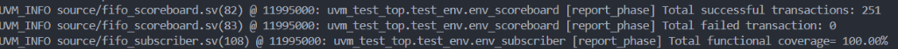

# FIFO_UVM_Verification

This project implements a SystemVerilog/UVM verification environment and SVA assertions for a Synchronous FIFO (16-bit data width, 8-entry depth). The main interface signals include `clk`, `rst_n`, `wr_en`, `rd_en`, `data_in`, `data_out`, along with status flags (`full`, `empty`, `almostfull`, `almostempty`, `wr_ack`, `overflow`, `underflow`).

For full port descriptions and the test plan (`TEST 1` to `TEST 4`), see [docs/FIFO_Spec_and_Verification_Plan.pdf](docs/FIFO_Spec_and_Verification_Plan.pdf).

## Project Structure

```text
FIFO_UVM_Verification/
├── docs/
│   ├── FIFO_Spec_and_Verification_Plan.pdf
│   └── sim_result.png
├── Rtl/
│   ├── fifo.sv
│   └── fifo_if.sv
├── source/
│   ├── fifo_agent.sv
│   ├── fifo_config_obj.sv
│   ├── fifo_driver.sv
│   ├── fifo_env.sv
│   ├── fifo_monitor.sv
│   ├── fifo_scoreboard.sv
│   ├── fifo_seq_item.sv
│   ├── fifo_sequence.sv
│   ├── fifo_sequencer.sv
│   ├── fifo_subscriber.sv
│   ├── fifo_sva.sv
│   ├── fifo_test.sv
│   └── testbench.sv
├── .gitignore
├── CHECKPOINTS.md
└── README.md
```

## DUT Specifications

- **Parameters**: `FIFO_WIDTH = 16`, `FIFO_DEPTH = 8`
- **Reset**: Asynchronous active-low `rst_n` clears `wr_ptr`, `rd_ptr`, `count`, `wr_ack`, and `overflow` to `0`.
- **Write / Read**: Writes are blocked when `full == 1`; reads are blocked when `empty == 1` with a 1-cycle registered `data_out` latency.
- **Simultaneous Read & Write**:
  - When `empty == 1`: read fails (`underflow = 1`), write succeeds, `count` increments by 1.
  - When `full == 1`: write fails (`overflow = 1` next cycle), read succeeds, `count` decrements by 1.
  - Otherwise: both succeed and `count` stays unchanged.

## Verification Architecture

- **UVM Components**: `FIFO_top` -> `FIFO_test` -> `FIFO_env` -> `FIFO_agent` (`FIFO_sequencer`, `FIFO_driver`, `FIFO_monitor`), `FIFO_scoreboard`, and `FIFO_subscriber`.
- **Sequences**: `FIFO_reset_sequence`, `FIFO_write_only_sequence` (100 writes), `FIFO_read_only_sequence` (100 reads), and `FIFO_read_write_sequence` (999 constrained-random transactions).
- **Scoreboard**: Uses `expected_data_q` and `read_latency_q` to check `data_out` across 1-cycle read latency and simultaneous read/write boundaries.
- **Coverage**: `FIFO_subscriber` collects single coverpoints and cross coverage across `wr_en`, `rd_en`, and all output status flags.
- **Assertions**: `FIFO_sva` is bound to `FIFO` in `source/testbench.sv` to check `wr_ptr`, `rd_ptr`, `count`, `wr_ack`, `overflow`, and status flags.

## Tools Used

- **Language & Methodology**: SystemVerilog, UVM 1.2, SVA
- **Simulator**: AMD Vivado Simulator 2025.1 (`xvlog`, `xelab`, `xsim`, `xcrg`)

## How to Run (Vivado CLI)

Run from the repository root directory:

```powershell
xvlog -sv -L uvm -i Rtl -i source Rtl/fifo_if.sv Rtl/fifo.sv source/testbench.sv
xelab -L uvm FIFO_top -s FIFO_top_sim -timescale 1ns/1ps
xsim FIFO_top_sim -R
```

To generate an HTML coverage report with `xcrg`:

```powershell
xcrg -cov_db_dir . -cov_db_name FIFO_top_sim -report_dir ./cov_report -report_format html
```

## Simulation Results

Verified on Vivado Simulator 2025.1 (UVM 1.2):

- **Total successful transactions**: `251`
- **Total failed transactions**: `0`
- **UVM_ERROR / UVM_FATAL**: `0` / `0`
- **Functional coverage**: `100.00%`



## Future Improvements

- Add a Python or Makefile script to automate compilation and simulation runs.
- Use industry-standard simulation tools (e.g., QuestaSim, VCS) to generate coverage reports automatically instead of printing them manually to the terminal.
- Add more corner-case test scenarios (if any).
